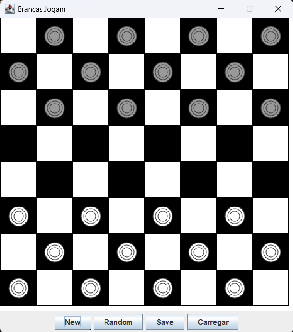

# Jogo de Damas (Java)

Jogo de damas para dois jogadores, com interface gráfica, desenvolvido em Java no 1.º ano da licenciatura em Engenharia Informática (Iscte). Projeto individual.

Esta versão é "sem damas": as peças nunca são promovidas. O tamanho do tabuleiro e o número de peças por equipa são configuráveis.

<!-- Adicionar aqui uma captura de ecrã do jogo a funcionar -->

## Como correr

1. Abre o projeto num IDE (Eclipse ou IntelliJ) com o JDK **[JKD 17]**.
2. Adiciona o ficheiro `guitoofw.jar` às bibliotecas do projeto. É a biblioteca gráfica fornecida pelos docentes da cadeira, e está incluída neste repositório.
3. Corre a classe `View` (tem o `main`). No terminal, indica o número de colunas do tabuleiro e o número de peças por equipa. Abre-se depois a janela do jogo.

O jogo carrega as imagens das peças (`white.png` e `black.png`) a partir da raiz do projeto, por isso tem de ser executado a partir dela.

## Como jogar

- Começam as brancas, que avançam para cima. As pretas avançam para baixo.
- Clica numa peça para a selecionar (fica a amarelo) e clica na casa de destino. Voltar a clicar na mesma peça desfaz a seleção.
- **Captura obrigatória:** se existir uma captura possível, tem de ser feita.
- **Menu do tabuleiro:**
  - **New:** novo jogo (pergunta o número de colunas e de peças).
  - **Random:** joga automaticamente uma jogada aleatória para a equipa da vez.
  - **Save / Carregar:** guarda ou carrega um jogo num ficheiro de texto. Indica o nome do ficheiro quando for pedido (podes usar um caminho, como `saves/exemplo.txt`).
- O jogo termina quando uma equipa fica sem peças ou sem jogadas possíveis. Neste último caso ganha quem tiver mais peças.

## Estrutura do código

- `Jogo.java`: o modelo do jogo. Guarda o tabuleiro, de quem é a vez, e implementa as regras (movimentos, capturas obrigatórias, deteção do fim do jogo) e a jogada aleatória.
- `View.java`: a interface gráfica e o ponto de entrada. Trata dos cliques, das ações do menu e de guardar e carregar jogos.
- `Position` (um `record`): linha e coluna de uma casa.

## Limitações conhecidas

É um projeto do 1.º ano e tem pontos por rever:

- Cada captura passa a vez ao adversário. Não há capturas em cadeia.
- A jogada aleatória é simples e não avalia a qualidade da jogada.

## Autor

João Pedro Almeida
